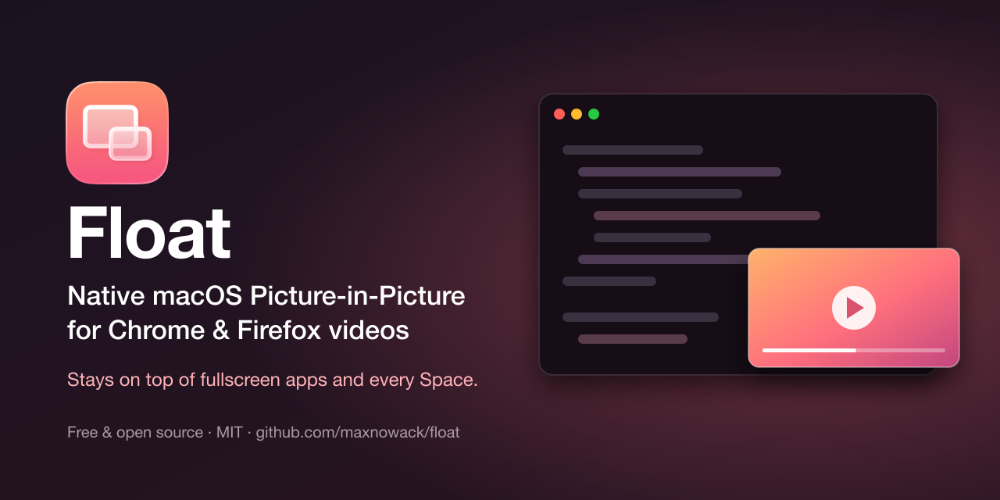

<h1 align="center">Float – Native Picture-in-Picture for Chrome &amp; Firefox on Mac</h1>

<p align="center">
  
</p>

<p align="center">
  <strong>Watch YouTube, Twitch and any web video in real macOS Picture-in-Picture,<br />
  even on top of fullscreen apps and across every Space.</strong>
</p>

<p align="center">
  <a href="https://github.com/maxnowack/float/releases/latest"></a>
  
  
  <a href="https://github.com/maxnowack/float/actions/workflows/ci.yml"></a>
  <a href="LICENSE"></a>
</p>

<p align="center">
  <a href="https://github.com/maxnowack/float/releases/latest"><strong>Download Float</strong></a> ·
  <a href="#install">Install</a> ·
  <a href="#faq">FAQ</a> ·
  <a href="#how-it-works">How it works</a>
</p>

---

## Why Float?

On a Mac, the Picture-in-Picture window you get in Chrome or Firefox is just a
browser window. Switch to a fullscreen app or another Space and the video
disappears. Safari and FaceTime don't have that problem because they use the
**system** Picture-in-Picture that macOS provides.

Float gives Chrome and Firefox the same native macOS PiP. A small browser
extension picks up the video on the page, and the Float menu bar app plays it in
the real system PiP window, so it stays visible over your editor, your
fullscreen Keynote or your game.

## Features

- **Real macOS Picture-in-Picture**: the same floating window Safari uses, with
  the native corner snapping, resizing and play/pause controls.
- **Stays on top of fullscreen apps**: keep watching while you work in a
  fullscreen IDE, design tool, terminal or presentation.
- **Follows you across Spaces and desktops**.
- **Works with Chrome and Firefox**: one menu bar app for both browsers.
- **Any HTML5 video**: YouTube, Twitch, Vimeo, course platforms, livestreams
  and most other sites that play a regular `<video>`, including videos inside
  iframes.
- **Auto-start and auto-stop**: optionally pop the video into PiP when you
  switch away from its tab and close it again when you come back.
- **Playback controls sync back**: pausing in the PiP window pauses the video in
  the browser, and the source tab is muted while Float plays its audio.
- **Audio stays in sync** with the picture, including a correction for
  Chrome's capture timing ([details](docs/AV_SYNC.md)).
- **Private and local**: the video never leaves your Mac. There are no servers,
  no accounts and no tracking. The browser and the app talk over an
  authenticated connection on `127.0.0.1` only.
- **Free and open source** (MIT), native on Apple Silicon and Intel.

## Float vs. built-in browser Picture-in-Picture

|                                                  | Chrome / Firefox PiP | **Float** |
| ------------------------------------------------ | :------------------: | :-------: |
| Floating video window                            |          ✅          |    ✅     |
| Visible on top of other apps' fullscreen windows |          ❌          |    ✅     |
| Follows you across Spaces                        |          ❌          |    ✅     |
| Native macOS PiP window and controls             |          ❌          |    ✅     |
| Auto PiP when you leave the tab                  |        Partly        |    ✅     |
| One PiP experience for Chrome and Firefox        |          ❌          |    ✅     |

## Install

**Requirements:** macOS 26.2 or later (Apple Silicon or Intel), plus Google
Chrome or Firefox 121+.

1. **Download** the companion app (`Float_companion_…_macOS_arm64.zip` for
   Apple Silicon, `…_x86_64.zip` for Intel) and the browser extension zip from
   the [latest release](https://github.com/maxnowack/float/releases/latest).
2. **Install the app:** unzip it, move `Float.app` to `/Applications` and open
   it. Float lives in your menu bar.
3. **Install the extension:**
   - **Chrome:** unzip the Chrome extension, open `chrome://extensions`, turn on
     **Developer mode** and choose **Load unpacked**.
   - **Firefox:** unzip the Firefox extension, open
     `about:debugging#/runtime/this-firefox` and choose
     **Load Temporary Add-on…**. Firefox removes temporary add-ons when it
     restarts.
4. **Pair the browser with the app** (one time per browser):
   right-click the Float menu bar icon, choose **Copy Sensitive Pairing
   Secret**, open the Float extension popup, paste it and click
   **Pair with Float**.

## Usage

1. Play a video in your browser.
2. Click the Float icon in the menu bar and pick the video.
3. The video jumps into native Picture-in-Picture. Drag it to any corner, resize
   it and switch to any app or Space.

Right-click the menu bar icon for settings: **Auto-start PiP**,
**Auto-stop PiP**, **Start at Login** and pairing options.

<details>
<summary>About pairing</summary>

Pairing is per extension installation and persists across browser and
companion restarts. To recover or revoke pairing, choose **Remove pairing** in
the extension popup or **Rotate Pairing Secret…** in the companion menu. A
rotation disconnects the current browser and invalidates the previous value.

The copied value is a long-lived credential: Float clears an unchanged
clipboard after successful pairing or 60 seconds, but you should still treat it
like a password.

</details>

## FAQ

### Why does Chrome's Picture-in-Picture disappear when I switch to a fullscreen app on Mac?

Chrome, Brave, Edge and Firefox draw their PiP video in an ordinary
always-on-top browser window. macOS gives every fullscreen app its own Space,
and browser windows are not shown there. Only the system Picture-in-Picture
window can float over other fullscreen apps. Float moves the browser video into
that system window.

### How do I get Picture-in-Picture for YouTube on a Mac with Chrome?

Install Float and its Chrome extension, play the YouTube video, then pick it
from the Float menu bar icon. Turn on **Auto-start PiP** if you want the video
to pop out when you switch tabs.

### Does Float work with Netflix, Disney+ or Prime Video?

No. These services protect their streams with DRM, and browsers don't allow
extensions to capture DRM-protected video. On a Mac, Safari's built-in
Picture-in-Picture is the best option for them.

### Does it work in Brave, Edge, Arc or other Chromium browsers?

The Chrome extension is a standard Manifest V3 extension and should load in
Chromium-based browsers, but only Chrome and Firefox are tested. Reports are
welcome.

### Do I need Float in Safari?

No. Safari already uses native macOS Picture-in-Picture.

### Is Float safe? Does it send my video anywhere?

The stream stays on your Mac. The companion listens only on `127.0.0.1`,
requires an authenticated, paired browser extension and uses no STUN/TURN
servers. See [`SECURITY.md`](SECURITY.md) for the full threat model.

### Why is there a separate app instead of just an extension?

Browser extensions can't use the system Picture-in-Picture of macOS. The
companion app is the part that can.

## Known issues and limitations

- **Quality ramps up:** Float puts audio quality first. Video bitrate and
  resolution start lower when a stream begins and improve as the connection
  adapts.
- **Chrome vs. Firefox:** Chrome delivers higher resolution and overall better
  quality. Firefox is lower, but fine at PiP size.
- **Firefox audio bug:** because of a
  [Firefox bug](https://developer.mozilla.org/en-US/docs/Web/API/HTMLMediaElement/captureStream#firefox-specific-notes),
  audio does not return to the page after Picture-in-Picture ends. Reload the
  page to get it back.
- **DRM-protected video** (Netflix, Disney+, Prime Video and similar) can't be
  captured.

## How it works

The browser content script discovers `<video>` elements and uses
`captureStream()` to create the media source. Its extension background context
handles authenticated signaling. The sandboxed macOS companion receives the
local WebRTC stream, renders video through Metal, plays its audio, and presents
it in the system Picture-in-Picture window via the private `PIP.framework`.

Signaling binds only IPv4 `127.0.0.1:17891`; Float does not advertise the
service or configure WebRTC STUN/TURN servers. Loopback alone is not trusted.
The companion validates the browser-extension Origin and requires protocol v2
HMAC authentication with a 256-bit per-install secret stored in the macOS
Keychain and background-owned extension IndexedDB.

See [`SECURITY.md`](SECURITY.md) for the threat model and
[`docs/PROTOCOL_V2.md`](docs/PROTOCOL_V2.md) for the wire protocol and limits.

### Why the private PIP.framework?

The public AVKit Picture-in-Picture API was tested and proved unstable for this
use case ([evaluation](docs/PUBLIC_PIP.md)). Float therefore uses the private
`PIP.framework` behind the system PiP window. This works well for local use, but
means Float can't ship through the Mac App Store.

## Contributing

Issues and pull requests are welcome, especially from macOS developers.

If Float is useful to you, a ⭐ on GitHub helps other people find it.

## Development

Float is split into:

- `extension/` (shared extension source + manifests)
- `companion/` (macOS receiver + native PiP)
- `scripts/` (build/pack/release helpers)

The extension code is shared with two explicit manifests: one for Chrome and one for Firefox.
The companion uses the exact pinned LiveKit WebRTC binary described in
[`docs/DEPENDENCIES.md`](docs/DEPENDENCIES.md). Its macOS framework and the
Float app support both `arm64` and `x86_64`.

Basic commands:

```bash
corepack enable
yarn --cwd extension install --frozen-lockfile
yarn --cwd extension test
./scripts/build-all.sh
```

Extension-only commands:

```bash
./scripts/build-chrome.sh
./scripts/build-firefox.sh
```

Companion tests and an unsigned local build:

```bash
FLOAT_UNSIGNED=1 ./scripts/build-companion.sh Debug arm64

xcodebuild test \
  -project companion/Float.xcodeproj \
  -scheme Float \
  -configuration Debug \
  -destination 'platform=macOS,arch=arm64' \
  CODE_SIGNING_ALLOWED=NO
```

## License

[MIT](LICENSE). Third-party components are listed in
[`THIRD_PARTY_NOTICES.md`](THIRD_PARTY_NOTICES.md).
